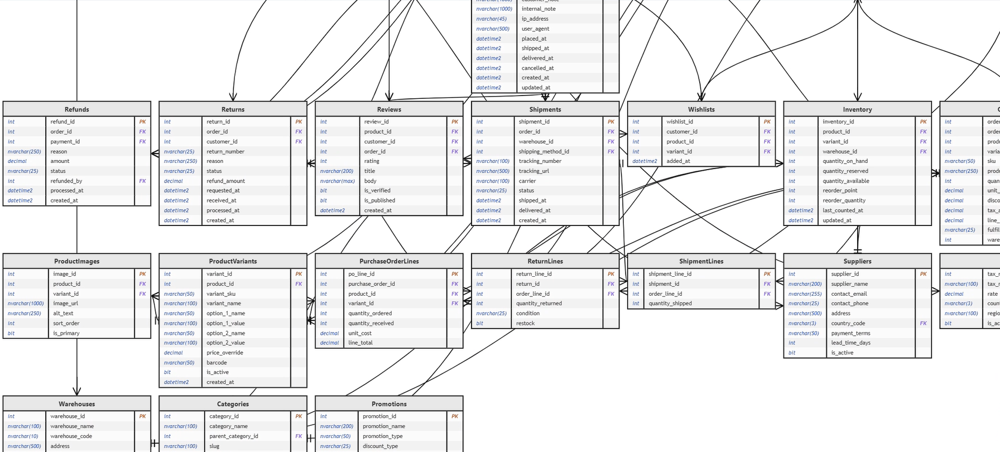

# Database Schema Visualiser - User Guide

## Overview

The Database Schema Visualiser is a custom Power BI visual that generates interactive Mermaid entity-relationship diagrams directly from your SQL Server metadata. It renders table structures, column details, primary keys, foreign key relationships, and data flow direction — all within your Power BI report. Because it reads from system views, it stays up to date automatically via scheduled refresh or Direct Query.



## Installation

1. Download the `dbSchemaVizA1B2C3D4E5F6G7H8.1.0.0.0.pbiviz` file from this repository
2. In Power BI Desktop, click the ellipsis (...) in the Visualizations pane
3. Select "Import a visual from a file"
4. Navigate to and select the downloaded `.pbiviz` file
5. Click "OK" to confirm the import

## Getting Started

### Step 1 — Create the Source Query

The visual requires a dataset built from SQL Server system views. Add the following query as a data source in Power BI (via **Get Data > SQL Server** or by pasting into an existing SQL source):

```sql
SELECT
    t.name AS table_name,
    c.column_id,
    c.name AS column_name,
    ty.name AS data_type,
    c.max_length,
    CAST(c.is_nullable AS varchar) AS is_nullable,
    CAST(c.is_identity AS varchar) AS is_identity,
    ISNULL(pk.is_primary_key, 0) AS is_primary_key,
    ISNULL(fk.referenced_table, '') AS fk_referenced_table
FROM sys.tables t
JOIN sys.columns c ON c.object_id = t.object_id
JOIN sys.types ty ON ty.user_type_id = c.user_type_id
LEFT JOIN (
    SELECT ic.object_id, ic.column_id, 1 AS is_primary_key
    FROM sys.index_columns ic
    JOIN sys.indexes i ON i.object_id = ic.object_id AND i.index_id = ic.index_id
    WHERE i.is_primary_key = 1
) pk ON pk.object_id = c.object_id AND pk.column_id = c.column_id
LEFT JOIN (
    SELECT fkc.parent_object_id, fkc.parent_column_id,
           OBJECT_NAME(fkc.referenced_object_id) AS referenced_table
    FROM sys.foreign_key_columns fkc
) fk ON fk.parent_object_id = c.object_id AND fk.parent_column_id = c.column_id
```

> **Tip:** For Direct Query mode, paste the SQL directly into the native query dialog so the visual always reflects the live schema.

### Step 2 — Add the Visual to Your Report

1. Click the Database Schema Visualiser icon in the Visualizations pane
2. Drag the required columns into the corresponding field wells (see **Field Mapping** below)
3. Resize the visual to give the diagram enough room to render clearly

### Field Mapping

| Field Well | Source Column | Description |
|---|---|---|
| **Table Name** | `table_name` | Name of each table |
| **Column ID** | `column_id` | Ordinal position of the column |
| **Column Name** | `column_name` | Name of each column |
| **Data Type** | `data_type` | SQL data type (varchar, int, datetime, etc.) |
| **Max Length** | `max_length` | Maximum length of the column |
| **Is Nullable** | `is_nullable` | Whether the column allows NULLs |
| **Is Identity** | `is_identity` | Whether the column is an identity column |
| **Is Primary Key** | `is_primary_key` | 1 if the column is part of the primary key |
| **FK Referenced Table** | `fk_referenced_table` | Target table for foreign key relationships |

## How It Works

### Mermaid Diagram Generation

The visual reads the metadata you provide and automatically generates a **Mermaid ER diagram** that includes:

- **Tables as entities** — each table in your database is rendered as a box
- **Columns with types** — every column is listed with its SQL data type
- **Primary key markers** — PK columns are clearly labelled
- **Foreign key relationships** — arrows show referential links between tables
- **Data direction** — relationship lines indicate the direction of data flow (parent to child)

### Keeping the Schema Up to Date

Because the source query reads from `sys.tables`, `sys.columns`, and related system views, the diagram updates whenever the underlying data refreshes:

| Refresh Method | Behaviour |
|---|---|
| **Scheduled Refresh** | Schema diagram updates on each refresh cycle in the Power BI Service |
| **Direct Query** | Schema diagram reflects live database state on every interaction |
| **Manual Refresh** | Click "Refresh" in Power BI Desktop to pull the latest schema |

This means schema changes — new tables, renamed columns, added foreign keys — are automatically reflected without editing the report.

## Understanding the Diagram

### Entity Boxes

Each table appears as a labelled box containing its columns. Columns are displayed with:

- Column name
- Data type and length
- **PK** badge for primary key columns
- **FK** badge for foreign key columns

### Relationship Lines

Lines between entities represent foreign key relationships:

- The **arrow direction** shows data flow from the referencing (child) table to the referenced (parent) table
- Relationship cardinality is derived from the key structure

### Example Diagram Structure

```
┌─────────────────┐         ┌─────────────────┐
│     Orders      │         │    Customers    │
├─────────────────┤         ├─────────────────┤
│ PK OrderID int  │────────>│ PK CustID int   │
│ FK CustID int   │         │    Name varchar  │
│    OrderDate dt │         │    Email varchar │
└─────────────────┘         └─────────────────┘
```

## Use Cases

### Database Documentation
- Auto-generate living documentation of your database schema
- Share interactive diagrams with stakeholders who don't have database access
- Include in Power BI reports alongside data analysis for full context

### Development & DBA Workflows
- Quickly visualise table relationships when onboarding to a new database
- Validate foreign key structures after schema migrations
- Spot missing relationships or orphaned tables at a glance

### Data Governance & Auditing
- Track schema changes over time by comparing refresh snapshots
- Document data lineage and flow direction for compliance
- Identify nullable columns or missing primary keys across the schema

### Reporting & Collaboration
- Embed schema diagrams alongside operational dashboards
- Provide non-technical users with a visual map of the data behind their reports
- Use as a reference when building new Power BI data models

## Best Practices

### Query & Data
- **Filter large databases** — if your database has hundreds of tables, add a `WHERE t.name IN (...)` clause or `WHERE t.schema_id = SCHEMA_ID('dbo')` to focus on relevant tables
- **Use Direct Query for live schemas** — if your schema changes frequently, Direct Query ensures the diagram is always current
- **Use Scheduled Refresh for stable schemas** — for production databases that change infrequently, scheduled refresh avoids unnecessary load
- **Test the query first** — run the SQL in SSMS or Azure Data Studio to verify permissions and results before importing into Power BI

### Report Design
- **Give the visual space** — schema diagrams need room; use a full page or a dedicated report tab
- **Pair with filters** — add slicers to let users focus on specific schemas or table groups
- **Use alongside data visuals** — place the schema diagram on a reference page so users can understand the data model behind the numbers

### Security
- **Check permissions** — the SQL query reads from system views; the connecting account needs `VIEW DEFINITION` permission on the database
- **Avoid exposing sensitive metadata** — if table or column names contain sensitive information, consider filtering before publishing to the Power BI Service
- **Row-level security** — this visual reads metadata, not row data, so standard RLS does not apply; control access at the report or workspace level

## Troubleshooting

**Issue**: Visual is empty or shows no diagram
- Verify the SQL query returns data — run it in SSMS first
- Check that all field wells are populated with the correct columns
- Ensure the connecting account has `VIEW DEFINITION` permission on the database
- Confirm the query is not filtered to exclude all tables

**Issue**: Foreign key relationships are not showing
- Verify that foreign key constraints exist in the database (`sys.foreign_key_columns` must contain rows)
- Check the `fk_referenced_table` column in your query results — it should contain the target table name, not be empty
- Ensure the FK column mapping is correctly assigned in the visual field wells

**Issue**: Diagram is too small or cluttered
- Increase the visual size on the report canvas
- Filter the query to a subset of tables using a `WHERE` clause
- Use the visual's zoom or scroll controls if available

**Issue**: Schema changes are not appearing
- For Scheduled Refresh: check that the refresh has run since the schema change
- For Direct Query: verify the connection is live and not cached
- In Power BI Desktop: click **Refresh** on the Home ribbon to pull the latest data

**Issue**: Query fails with permission error
- The account used in the Power BI data source needs at minimum:
  - `VIEW DEFINITION` on the target database
  - `SELECT` on `sys.tables`, `sys.columns`, `sys.types`, `sys.indexes`, `sys.index_columns`, `sys.foreign_key_columns`
- Ask your DBA to grant `VIEW DEFINITION` if you see access denied errors

**Issue**: Diagram renders but data types show as incorrect
- Ensure you're joining on `ty.user_type_id = c.user_type_id` (not `system_type_id`) to get the correct user-facing type names
- Alias columns may override type names if you have user-defined types

## Technical Requirements

- Power BI Desktop (latest version recommended)
- SQL Server 2016+ or Azure SQL Database
- `VIEW DEFINITION` permission on the target database
- Recommended: a dedicated report page for the schema diagram
- Supports Import, Direct Query, and Composite connection modes

## Extending the Query

### Include Schema Names

To differentiate tables across schemas:

```sql
SELECT
    SCHEMA_NAME(t.schema_id) + '.' + t.name AS table_name,
    -- ... rest of the columns as above
```

### Filter to Specific Schemas

```sql
-- Add to the WHERE clause
WHERE t.schema_id = SCHEMA_ID('dbo')
```

### Filter to Specific Tables

```sql
-- Add to the WHERE clause
WHERE t.name IN ('Orders', 'Customers', 'Products', 'OrderDetails')
```

### Include Views

To also visualise views alongside tables:

```sql
-- Replace sys.tables with sys.objects and filter
FROM sys.objects t
-- ... rest of the query
WHERE t.type IN ('U', 'V')  -- U = User Table, V = View
```

## Support and Feedback

For issues, questions, or feature requests:
- Visit: http://powerbiwall.com/PBI-visuals
- Repository: https://github.com/PBI-Nathan/powerbi-visuals-database-schema

## Version Information

**Current Version**: 1.0.0.0

**Change Log**:
- Initial release with core schema visualisation functionality
- Mermaid ER diagram generation from SQL Server system metadata
- Foreign key relationship mapping with data direction indicators
- Primary key and identity column identification
- Support for Scheduled Refresh and Direct Query modes
